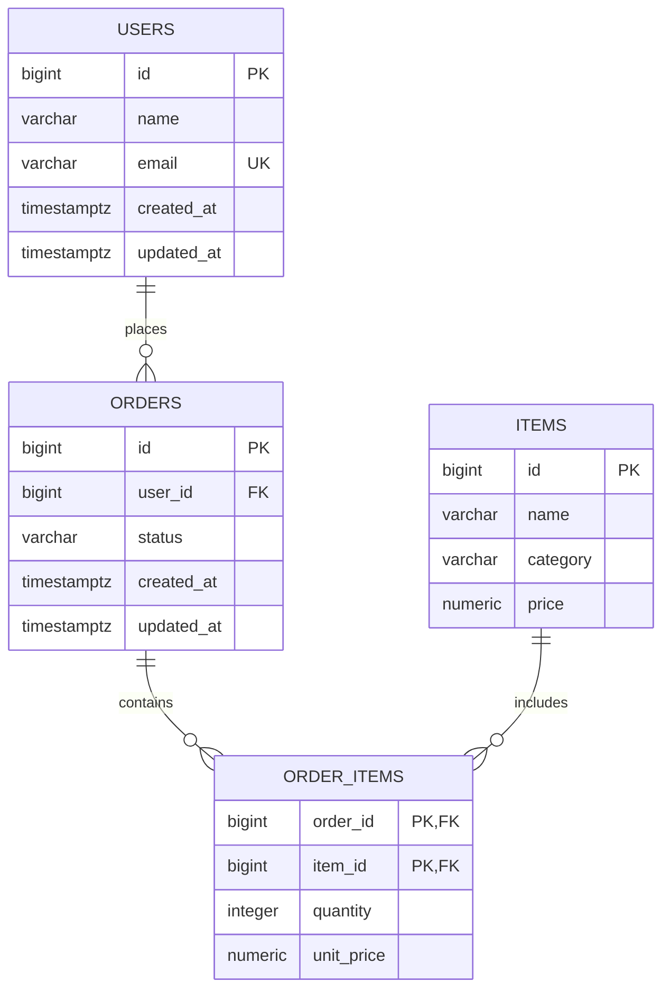

# Database

## Overview

The project uses PostgreSQL 18 as the primary database.

## Main entities 

- `users` - registered users;
- `items` - available items;
- `orders` - user orders;
- `order_items` - items included in orders.

## Schema

### `users`

Stores registered users.

| Column | Type | Nullable | Default | Constraints | Description |
|---|---|---|---|---|---|
| `id` | `INT` | No | Serial | PK | Unique user identifier |
| `name` | `TEXT` | No | - | - | User display name |
| `email` | `TEXT` | No | - | - | User email address |
| `created_at` | `TIMESTAMPTZ` | No | `now()` | - | Record creation time |
| `updated_at` | `TIMESTAMPTZ` | No | `now()` | - | Last update time |

### `items` 

Stores products available for ordering.

| Column | Type | Nullable | Default | Constraints | Description |
|---|---|---|---|---|---|
| `id` | `INT` | No | Serial | PK | Unique item identifier |
| `name` | `TEXT` | No | - | - | Item name |
| `category` | `TEXT` | No | - | - | Item category |
| `price` | `INT` | No | - | `CHECK (price > 0)` | Item price |

### `orders`

Stores orders created by users.

| Column | Type | Nullable | Default | Constraints | Description |
|---|---|---|---|---|---|
| `id` | `INT` | No | Serial | PK | Unique order identifier |
| `user_id` | `INT` | No | - | FK -> `users.id` | Order owner |
| `status` | `TEXT` | No | - | - | Current order status |
| `created_at` | `TIMESTAMPTZ` | No | `now()` | - | Order creation time |
| `updated_at` | `TIMESTAMPTZ` | No | `now()` | - | Last update time |

### `order_items`

Associates orders with items.

| Column | Type | Nullable | Default | Constraints | Description |
|---|---|---|---|---|---|
| `order_id` | `INT` | No | - | FK -> `orders.id` | Related order |
| `item_id` | `INT` | No | - | FK -> `items.id` | Related item |
| `quantity` | `INT` | No | - | `CHECK (quantity > 0)` | Ordered quantity |
| `unit_price` | `INT` | No | - | `CHECK (unit_price > 0)` | Item price at order time |

Primary key: `(order_id, item_id)`.

## Relationships



### Relationship details

- One `user` can have many `orders`;
- Each `order` belongs to one `user`;
- One `order` can contain multiple `items`;
- One `item` can belong to multiple `orders`;
- `order_items` represents the many-to-many relationship between `orders` and `items`.

## Constraints

### Users
- `users.id` is the primary key (PK). 
- `users.email` must by unique.

### Orders 
- `orders.user_id` references `users.id`.

### Order items
- `(order_id, item_id)` is the primary key.
- `order_items.order_id` references to `orders.id`.
- `order_items.item_id` references to `items.id`.
- `order_items.quantity` must be greater than zero.
- `order_items.unit_price` must be greater than zero.

### Items 
- `items.price` must be greater than zero.

## Triggers

The database uses a shared trigger function to automatically update `updated_at` before a record is modified.

### `set_updated_at()`

```sql
CREATE OR REPLACE FUNCTION setupdated_at()
RETURNS trigger 
```

The function sets:
```sql
NEW.updated_at = now()
```

The trigger is applied to:
- `users`
- `orders`

This guarantees that `updated_at` reflects the latest modification time.

## Migrations

Database schema changes are managed using SQL migrations.

| Version | Migration | Description |
| `001` | `001_init_schema` | Creates the initial database schema |
| `002` | `002_updated_at_triggers` | Adds `updated_at` trigger function and triggers |

Each migration consists of:
- `.up.sql` - applies migration;
- `.down.sql` - reverts migration.

## Seed data 

Development data is provided by `seed.sql`.

This seed script generates:
- 1,000 users;
- predefined items;
- 20,000 orders;
- 1-4 items per order.

User registration dates are randomly distributed over the previous 365 days.

Order dates are generated between the corresponding user's registration date
and the current time.

The seed script is intended for development and testing only.

## Database Initialization

The database should be initialized in the following order:
1. Apply migrations.
2. Apply seed data if development data is required. 
